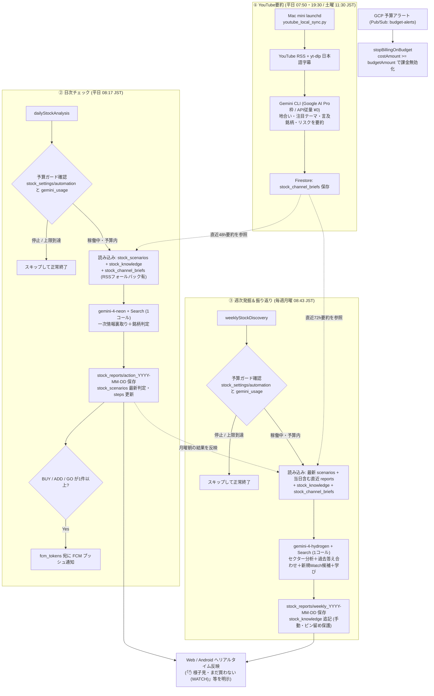

# Hibi 株自動分析パイプライン フロー説明

[English](stock-analysis-flow.md) | 日本語

Hibi の株分析は、**① YouTube 参考要約（07:50）→ ② 平日日次チェック（08:17）→ ③ 月曜週次発掘＆振り返り（08:43）** の順で依存関係に沿って動作します。実行基盤として Firebase Cloud Functions v2（Blaze プラン + Cloud Scheduler `Asia/Tokyo`）と Pub/Sub 予算自動停止ガードを備え、ローカル Mac mini の `launchd` ジョブで YouTube マーケット解説の自動要約を取り込みます（手動検証用に CLI からも [stock_pipeline.py](../functions-stock/stock_pipeline.py) を実行可能）。

- **① ローカル YouTube 要約（Mac mini `launchd` / 平日 07:50・19:30・土曜 11:30 JST）**: `@yasutakaushiroda`（「後田泰孝のマーケット解説」）の配信を字幕＋Google AI Pro 枠の `gemini` CLI で要約し、Firestore `stock_channel_briefs` に保存（API 従量課金 ¥0）。
- **② 平日毎朝チェック（`dailyStockAnalysis` / 08:17 JST）**: 直前の YouTube 要約（または RSS フォールバック）を取り込みつつ、保有中・Watch 中の既存銘柄に対する買い時・買い増し・見直し判定とスケジュールを更新（1 コール省エネ実行）。
- **③ 毎週月曜週次発掘（`weeklyStockDiscovery` / 08:43 JST）**: YouTube 要約と月曜 08:17 の日次判定結果を踏まえ、マクロ＆中長期セクター動向、過去 1〜4 週間の答え合わせ（Human-on-the-loop ナレッジ自動追記）、重複しない新規 Watch 候補（2〜3 銘柄）を発掘（週 1 回実行）。

---

## 1. 全体フロー（YouTube → 日次 → 週次 ＋ 二重予算ガード）



---

## 2. 構成モジュールとスケジュール

### Python モジュール構成（`functions-stock/` & `scripts/stock-analysis/`）

| ファイル | 役割 |
| --- | --- |
| [gemini_client.py](../functions-stock/gemini_client.py) | `GeminiClient`・モデル単価計算・思考パート除外 |
| [scenario_parser.py](../functions-stock/scenario_parser.py) | 銘柄キー正規化・分割ステップ補完・破損 JSON リカバリ |
| [firestore_store.py](../functions-stock/firestore_store.py) | Firestore 読み書き・ナレッジ厳選/自動整理・予算ガード・FCM 通知 |
| [youtube_channel.py](../functions-stock/youtube_channel.py) | YouTube RSS 解析・`stock_channel_briefs` 読込・RSS 目次フォールバック |
| [stock_pipeline.py](../functions-stock/stock_pipeline.py) | `run_daily()`・`run_weekly()`・CLI エントリーポイント |
| [youtube_local_sync.py](../scripts/stock-analysis/youtube_local_sync.py) | ローカル Mac 用：`yt-dlp` 字幕クリーニング＋`gemini` CLI 要約＋Firestore 登録 |

### 実行順とスケジュール一覧（JST）

| 実行順 | ジョブ名 | 実行環境 | トリガー / 時刻 | 役割 | 定義ファイル |
| --- | --- | --- | --- | --- | --- |
| ① | `com.hibi.youtube-sync` | Mac mini (`launchd`) | 平日 07:50・19:30 / 土 11:30 JST | `@yasutakaushiroda` の配信をローカル要約 | [install_launchd.sh](../scripts/stock-analysis/install_launchd.sh) |
| ② | `dailyStockAnalysis` | Python 3.13 (`asia-northeast1`) | `17 8 * * 1-5`（平日 08:17 JST） | 毎朝の保有・Watch判定＆スケジュール更新 | [main.py](../functions-stock/main.py) |
| ③ | `weeklyStockDiscovery` | Python 3.13 (`asia-northeast1`) | `43 8 * * 1`（月曜 08:43 JST） | 週次セクター＆候補発掘＆学び振り返り | [main.py](../functions-stock/main.py) |
| 通知 | `checkStockReminders` | Node.js 24 (`asia-northeast1`) | `30 8 * * *`（毎日 08:30 JST） | `notifyDate <= 今日` の購入リマインド FCM | [index.ts](../functions/src/index.ts) |
| 保護 | `stopBillingOnBudget` | Node.js 24 (`asia-northeast1`) | Pub/Sub `budget-alerts` | 実コストが GCP 予算到達時に課金無効化 | [index.ts](../functions/src/index.ts) |

> 補足：`firebase.json` の `predeploy` が `.agents/skills/` を `functions-stock/skills/` へ自動同梱します。CLI・テスト用の [run_pipeline.py](../scripts/stock-analysis/run_pipeline.py) も共通モジュール [stock_pipeline.py](../functions-stock/stock_pipeline.py) を直接参照しています。

---

## 3. 各パイプラインの詳細

### 共通ステップ: 上限ガード・ナレッジ・YouTube 参考情報・シナリオ読み込み
1. 公開 API（`frankfurter.dev` / `open.er-api.com`）から USD/JPY レートを取得します（失敗時は `159.0`）。
2. `check_automation_guard()` が Firestore を確認し、手動停止（`enabled == false`）または `gemini_usage/{YYYY-MM}` の推計額が `monthlyBudgetJpy` 以上（初期 `¥1,000`）なら Gemini API を呼ばず終了します。
3. `load_active_knowledge()` が `stock_knowledge` を読み込み、ピン留め済み（`isPinned: true`）を優先したうえで最大 12 件・1,800 文字以内でプロンプトへ注入します。
4. `load_recent_channel_briefs()` が直近の `stock_channel_briefs`（日次は 48 時間以内、週次は 72 時間以内）を読み込みます。Mac がスリープ中などで未保存の動画があれば、YouTube 公式 RSS のタイトル・概要欄目次を自動で補います。
5. `load_active_scenarios()` が `HOLDING`（保有中）と `WATCH`（注目・様子見）を読み込み、`ARCHIVED` を除外します。

### 平日毎朝: `run_daily()`（08:17 JST / 1 コール）
- **モデル**: `gemini-4-neon`（Temperature `0.3` / Google Search 有効 / `maxOutputTokens: 16384` / タイムアウト 300 秒）
- **使用スキル**: [stock-risk-gatekeeper](../.agents/skills/stock-risk-gatekeeper/SKILL.md)
- **処理内容**:
  1. `active_count == 0` の場合は API を呼ばず終了します。
  2. `stock_knowledge` と YouTube チャンネル要約を参考にしつつ、Web 検索による最新株価・一次情報と照合して地合いサマリー（3〜5 行）・各銘柄判定（`ADD`/`HOLD`/`TRIM`/`BUY`/`WATCH`/`DROP`）・現在値比の一言診断（`oneLiner`）を生成します（YouTube 情報は盲信せず、裏取りできた論点のみ反映）。
  3. `stock_reports/action_{YYYY-MM-DD}` を保存し、`stock_scenarios` の `latestVerdict`・`latestVerdictReason`・`latestCheckedAt`・未購入 `steps` を更新／補完します（`isDone = true` は保護）。
  4. `BUY` / `ADD` / `GO` が 1 件以上あれば FCM 通知を送信します。
  5. Android アプリ・Web コンソール上では、`WATCH` / `WAIT` は「✋ 様子見・まだ買わない」、`TRIM` / `ABORT` は「⛔ 買いNG・警戒」として色分け・見出し表示されます。

### 毎週月曜朝: `run_weekly()`（08:43 JST / 1 コール）
- **モデル**: `gemini-4-hydrogen`（Thinking HIGH / Google Search 有効 / タイムアウト 300 秒）
- **使用スキル**: `stock-market-analyzer` / `sector-analyzer` / `stock-screener`
- **処理内容**:
  1. `load_recent_reports_summary()` で過去 1〜4 週間（同日 08:17 の `daily_action` 含む）の候補・判定履歴を抽出し、現在値で答え合わせします。
  2. 中長期（6 ヶ月〜2〜3 年）の追い風／逆風セクターと、重複しない新規 Watch 候補（2〜3 銘柄、`notifyDate` 付き分割 `steps`）を生成し、`stock_reports/weekly_{YYYY-MM-DD}` に保存します。
  3. 振り返りから得られた新しい教訓（`learnedKnowledge`, 0〜2 件）を `save_learned_knowledge()` で `stock_knowledge` へ自動保存します（タグ：`AI自動振り返り`、`isPinned: false`）。
     - 既存データ保護ルール：手動登録の既存ナレッジおよびピン留め済み項目は削除されません。上限（8 件）超過時は「`isPinned: false` かつ `AI自動振り返り` タグ付き」の古い AI メモだけを順に整理します。

---

## 4. セットアップ手順

### A. インフラ自動停止（Blaze）の初回セットアップ
1. **Firebase Blaze プランを有効化**（Firebase Console で対象プロジェクト `kabu-99c48` に請求先アカウントを紐付け）。
2. **Gemini API キーを Secret Manager へ登録＆関数デプロイ**:
   ```zsh
   firebase functions:secrets:set GEMINI_API_KEY
   firebase deploy --only functions
   ```
3. **Google Cloud Billing 予算と Pub/Sub を接続**:
   - Google Cloud Console の「請求 ＞ 予算とアラート」で対象プロジェクトの月額予算を作成し、通知先 Pub/Sub トピックに `budget-alerts` を指定します。
4. **IAM 権限付与**:
   - Cloud Functions 実行サービスアカウントに対し、請求先アカウント上で `roles/billing.projectManager`（請求プロジェクト管理者）を付与すると、`stopBillingOnBudget` が実コスト超過時に課金を自動無効化できます。

### B. ローカル Mac mini での YouTube 自動要約セットアップ
1. **本体スリープ無効化（画面オフのみ許可）**: 「システム設定」＞「エネルギー」＞「ディスプレイがオフのときに自動スリープしないようにする」をオンにします。
2. **Gemini CLI 認証**: ターミナルで `gemini` を起動し、Google AI Pro 契約アカウントでログインします。
3. **サービスアカウント JSON の配置と登録**:
   ```zsh
   mkdir -p ~/.config/hibi
   # Firebase Console からダウンロードした秘密鍵を配置
   mv ~/Downloads/kabu-99c48-*.json ~/.config/hibi/firebase-service-account.json
   chmod 600 ~/.config/hibi/firebase-service-account.json

   # 動作確認と launchd 定期実行登録
   ./scripts/stock-analysis/run_youtube_local.sh --limit 1
   ./scripts/stock-analysis/install_launchd.sh
   ```
