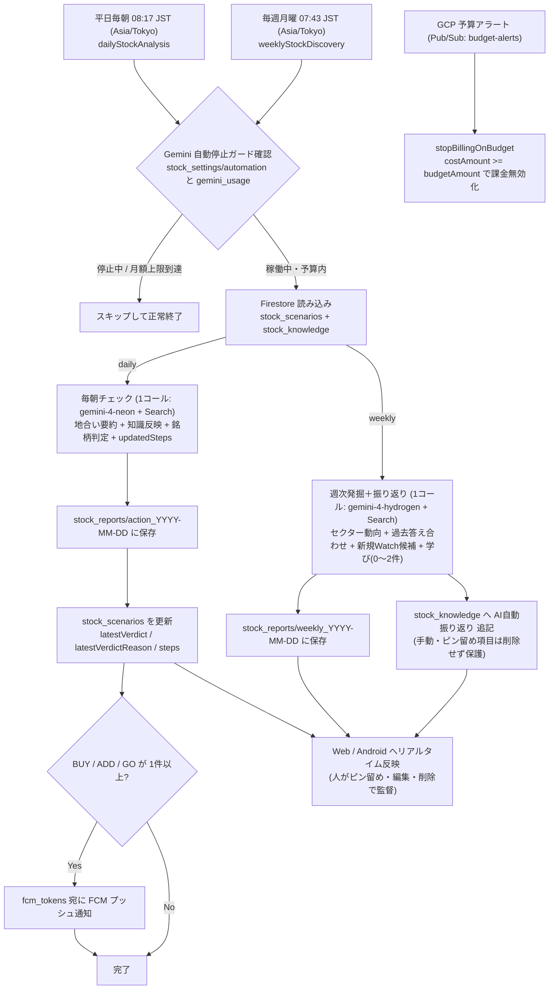

# Hibi 株自動分析パイプライン フロー説明

Hibi の株分析は、**中長期投資（6ヶ月〜2〜3年＋押し目分割買い）** と **API コスト抑制** に合わせて、役割を次の 2 つに分離しています。実行基盤として **Firebase Cloud Functions v2（Blaze プラン + Cloud Scheduler `Asia/Tokyo`）** と **Pub/Sub 予算自動停止ガード** を備えています（手動検証用に GitHub Actions / CLI からも同じ [stock_pipeline.py](file:///Users/toshinao/wk/hibi/functions-stock/stock_pipeline.py) を実行可能）。

- **平日毎朝（`dailyStockAnalysis` / 08:17 JST）**: 保有中・Watch 中の既存銘柄に対する買い時・買い増し・見直し判定とスケジュール更新（**1 コール省エネ実行**）
- **毎週月曜朝（`weeklyStockDiscovery` / 07:43 JST）**: マクロ＆中長期セクター動向、過去 1〜4 週間の答え合わせ（Human-on-the-loop ナレッジ自動追記）、重複しない新規 Watch 候補（2〜3 銘柄）の発掘（**週 1 回実行**）

---

## 1. 全体フロー（Human-on-the-loop ＋ 二重予算ガード）



---

## 2. Cloud Functions 構成とスケジュール

| 関数名 | ランタイム / 種別 | トリガー / 時刻 | 役割 | 定義ファイル |
| --- | --- | --- | --- | --- |
| `dailyStockAnalysis` | Python 3.13 (`asia-northeast1`) | `17 8 * * 1-5` (`Asia/Tokyo`) | 平日 08:17 JST 毎朝チェック | [main.py](file:///Users/toshinao/wk/hibi/functions-stock/main.py) |
| `weeklyStockDiscovery` | Python 3.13 (`asia-northeast1`) | `43 7 * * 1` (`Asia/Tokyo`) | 月曜 07:43 JST 週次発掘＆振り返り | [main.py](file:///Users/toshinao/wk/hibi/functions-stock/main.py) |
| `checkStockReminders` | Node.js 24 (`asia-northeast1`) | `30 8 * * *` (`Asia/Tokyo`) | `notifyDate <= 今日` の購入リマインド FCM | [index.ts](file:///Users/toshinao/wk/hibi/functions/src/index.ts) |
| `stopBillingOnBudget` | Node.js 24 (`asia-northeast1`) | Pub/Sub `budget-alerts` | 実コストが GCP 予算到達時に課金無効化 | [index.ts](file:///Users/toshinao/wk/hibi/functions/src/index.ts) |

> **補足**: `firebase.json` の `predeploy` が `.agents/skills/` を `functions-stock/skills/` へ自動同梱します。CLI・テスト用の [run_pipeline.py](file:///Users/toshinao/wk/hibi/scripts/stock-analysis/run_pipeline.py) も共通モジュール [stock_pipeline.py](file:///Users/toshinao/wk/hibi/functions-stock/stock_pipeline.py) を直接参照しています。

---

## 3. 各パイプラインの詳細

### 共通ステップ: Gemini 上限ガード・ナレッジ読み込み・シナリオ読み込み
1. 公開 API（`frankfurter.dev` / `open.er-api.com`）から USD/JPY レートを取得します（失敗時は `159.0`）。
2. `check_automation_guard()` が Firestore を確認し、手動停止（`enabled == false`）または `gemini_usage/{YYYY-MM}` の推計額が `monthlyBudgetJpy` 以上（初期 `¥1,000`）なら Gemini API を呼ばず終了します。
3. `load_active_knowledge()` が `stock_knowledge` を読み込み、**📌 ピン留め済み（`isPinned: true`）を優先** したうえで最大 12 件・1,800 文字以内でプロンプトへ注入します。
4. `load_active_scenarios()` が `HOLDING`（保有中）と `WATCH`（注目中）を読み込み、`ARCHIVED` を除外します。

### 平日毎朝: `run_daily()`（1 コール）
- **モデル**: `gemini-4-neon`（Temperature `0.3` / Google Search 有効 / `maxOutputTokens: 16384` / タイムアウト 300 秒）
- **使用スキル**: [.agents/skills/stock-risk-gatekeeper/SKILL.md](file:///Users/toshinao/wk/hibi/.agents/skills/stock-risk-gatekeeper/SKILL.md)
- **処理内容**:
  1. `active_count == 0` の場合は API を呼ばず終了します。
  2. 登録済み `stock_knowledge` を踏まえたうえで、地合いサマリー（3〜5 行）・各銘柄判定（`ADD`/`HOLD`/`TRIM`/`BUY`/`WATCH`/`DROP`）・現在値比の一言診断（`oneLiner`）を生成します。
  3. `stock_reports/action_{YYYY-MM-DD}` を保存し、`stock_scenarios` の `latestVerdict`・`latestVerdictReason`・`latestCheckedAt`・未購入 `steps` を更新／補完します（`isDone = true` は保護）。
  4. `BUY` / `ADD` / `GO` が 1 件以上あれば FCM 通知を送信します。

### 毎週月曜朝: `run_weekly()`（1 コール）
- **モデル**: `gemini-4-hydrogen`（Thinking HIGH / Google Search 有効 / タイムアウト 300 秒）
- **使用スキル**: `stock-market-analyzer` / `sector-analyzer` / `stock-screener`
- **処理内容**:
  1. `load_recent_reports_summary()` で過去 1〜4 週間の候補・判定履歴を抽出し、現在値で答え合わせします。
  2. 中長期（6 ヶ月〜2〜3 年）の追い風／逆風セクターと、重複しない新規 Watch 候補（2〜3 銘柄、`notifyDate` 付き分割 `steps`）を生成し、`stock_reports/weekly_{YYYY-MM-DD}` に保存します。
  3. 振り返りから得られた新しい教訓（`learnedKnowledge`, 0〜2 件）を `save_learned_knowledge()` で `stock_knowledge` へ自動保存します（タグ：`AI自動振り返り`、`isPinned: false`）。
     - **既存データ保護ルール**：手動登録の既存ナレッジおよび 📌 ピン留め済み項目は **絶対に削除されません**。上限（8 件）超過時は「`isPinned: false` かつ `AI自動振り返り` タグ付き」の古い AI メモだけを順に整理します。

---

## 4. インフラ自動停止（Blaze）の初回セットアップ手順

1. **Firebase Blaze プランを有効化**（Firebase Console で対象プロジェクト `kabu-99c48` に請求先アカウントを紐付け）。
2. **Gemini API キーを Secret Manager へ登録＆関数デプロイ**:
   ```sh
   npx firebase functions:secrets:set GEMINI_API_KEY
   npx firebase deploy --only functions
   ```
   （※初回デプロイで Cloud Scheduler と Pub/Sub トピック `budget-alerts` が自動作成されます）
3. **Google Cloud Billing 予算と Pub/Sub を接続**:
   - Google Cloud Console の「請求 ＞ 予算とアラート」で対象プロジェクトの月額予算（例：`¥500`）を作成し、通知先 Pub/Sub トピックに `budget-alerts` を指定します。
4. **IAM 権限付与**:
   - Cloud Functions 実行サービスアカウント（通常 `<project-number>-compute@developer.gserviceaccount.com` または App Engine 既定 SA）に対し、プロジェクトまたは請求先アカウント上で `roles/billing.projectManager`（請求プロジェクト管理者）を付与すると、`stopBillingOnBudget` が実コスト超過時に課金を自動無効化できるようになります。
5. **Cloud Functions 稼働確認後**:
   - 従来の GitHub Actions 定時スケジュール（[stock-analysis.yml](file:///Users/toshinao/wk/hibi/.github/workflows/stock-analysis.yml) の `schedule`）は重複実行を防ぐため削除／無効化できます。
