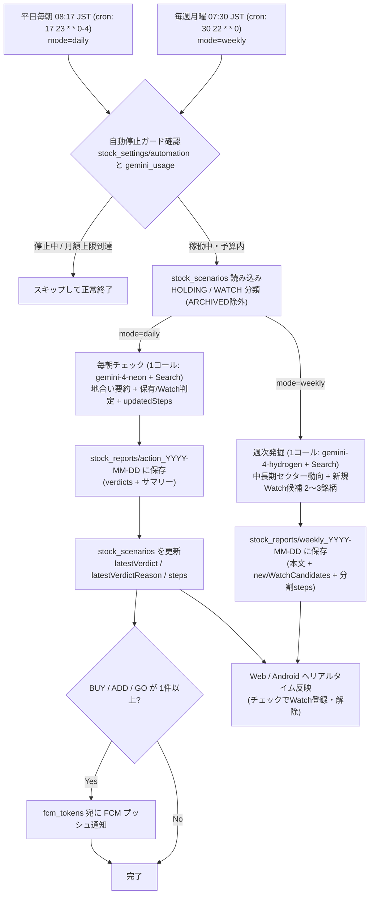

# Hibi 株自動分析パイプライン フロー説明

Hibi の株分析は、**中長期投資（6ヶ月〜2〜3年＋押し目分割買い）** と **API コスト抑制** に合わせて、役割を次の 2 つに分離しています。

- **平日毎朝（`daily` / 08:17 JST）**: 保有中・Watch 中の既存銘柄に対する買い時・買い増し・見直し判定とスケジュール更新（**1 コール省エネ実行**）
- **毎週月曜朝（`weekly` / 07:30 JST）**: マクロ＆中長期セクター動向の確認と、重複しない新規 Watch 候補（2〜3 銘柄）の発掘（**週 1 回実行**）

---

## 1. 全体フロー



---

## 2. 起動タイミングと実行モード

ワークフロー定義は [stock-analysis.yml](file:///Users/toshinao/wk/hibi/.github/workflows/stock-analysis.yml) にあります。

- **平日毎朝（`daily`）**: 毎週月〜金曜 **08:17 JST**（`cron: '17 23 * * 0-4'` / UTC 日〜木 23:17）に自動実行されます。
- **毎週月曜（`weekly`）**: 毎週月曜 **07:30 JST**（`cron: '30 22 * * 0'` / UTC 日曜 22:30）に自動実行されます。
- **手動実行（`workflow_dispatch`）**: GitHub Actions から `mode`（`daily` / `weekly` / `all`）と使用モデルを選んで実行できます。

---

## 3. 各パイプラインの詳細（[run_pipeline.py](file:///Users/toshinao/wk/hibi/scripts/stock-analysis/run_pipeline.py)）

### 共通ステップ: 自動停止ガード・為替レート取得・シナリオ読み込み
1. 公開 API（`frankfurter.dev` / `open.er-api.com`）から USD/JPY レートを取得します（失敗時は `159.0`）。
2. `check_automation_guard()` が Firestore を確認し、次の場合は Gemini API を呼ばずに終了します。
   - `stock_settings/automation` の `enabled` が `false`（手動停止スイッチ OFF）
   - `gemini_usage/{YYYY-MM}` の当月推計コスト（`estimatedCostUsd * usdToJpyRate`）が `monthlyBudgetJpy` 以上（初期上限 `¥1,000`）
3. `load_active_scenarios()` が `stock_scenarios` から `HOLDING`（保有中）と `WATCH`（注目中）を読み込み、`ARCHIVED`（見送り）を除外します。

### 平日毎朝: `run_daily()`（1 コール）
- **モデル**: `gemini-4-neon`（Temperature `0.3` / Google Search 有効 / `maxOutputTokens: 16384` / タイムアウト 300 秒）
- **使用スキル**: [.agents/skills/stock-risk-gatekeeper/SKILL.md](file:///Users/toshinao/wk/hibi/.agents/skills/stock-risk-gatekeeper/SKILL.md)
- **処理内容**:
  1. `active_count == 0` の場合は API を呼ばず終了します。
  2. 冒頭に日米指数・金利・ドル円・今週イベントの地合いサマリー（3〜5 行）をまとめます（セクター分析・新規候補出しは行いません）。
  3. `HOLDING` 銘柄には `ADD`（買い増し）/ `HOLD`（保有継続）/ `TRIM`（縮小・警戒）、`WATCH` 銘柄には `BUY`（買い好機）/ `WATCH`（監視継続）/ `DROP`（削除提案）を判定します。
  4. `oneLiner` に **現在株価と、今買うべきか／いくらまで待つか／いつ再確認するか** を出力します。
  5. `stock_reports/action_{YYYY-MM-DD}` にレポートを保存し、各銘柄の `latestVerdict`・`latestVerdictReason`・`latestCheckedAt` を更新します。
  6. 仮 1 ステップのみ・`notifyDate` 未設定・価格見直しが必要な銘柄は、購入済み（`isDone = true`）ステップを保持したまま未購入ステップ（`steps`）を更新・補完します。
  7. `BUY` / `ADD` / `GO` が 1 件以上あれば `fcm_tokens` へプッシュ通知を送信します。

### 毎週月曜朝: `run_weekly()`（1 コール）
- **モデル**: `gemini-4-hydrogen`（Thinking HIGH / Google Search 有効 / タイムアウト 300 秒）
- **使用スキル**:
  - [.agents/skills/stock-market-analyzer/SKILL.md](file:///Users/toshinao/wk/hibi/.agents/skills/stock-market-analyzer/SKILL.md)
  - [.agents/skills/sector-analyzer/SKILL.md](file:///Users/toshinao/wk/hibi/.agents/skills/sector-analyzer/SKILL.md)
  - [.agents/skills/stock-screener/SKILL.md](file:///Users/toshinao/wk/hibi/.agents/skills/stock-screener/SKILL.md)
- **処理内容**:
  1. 登録済みの `HOLDING` / `WATCH` 銘柄を除外対象として渡し、重複提案を防ぎます。
  2. 金利・為替・業績モメンタムを踏まえた **中長期（6ヶ月〜2〜3年）の追い風セクター（2〜3業種）と逆風セクター** を整理します。
  3. **新規 Watch 候補（2〜3 銘柄）** を選定し、現在値と狙い目価格帯（`targetHorizon`）、選定理由（`reason`）、**具体的な `notifyDate`（`YYYY-MM-DD`）入りの 2〜3 回分割購入ステップ（`steps`）** を生成します。
  4. `stock_reports/weekly_{YYYY-MM-DD}`（`type: "weekly_screener"`）に保存します。

---

## 4. アプリ側（Web / Android）との連動

| 操作・機能 | 挙動 | 対象ファイル |
| --- | --- | --- |
| **週次候補のチェック ON** | 候補の分割ステップ（未設定時は +7日 / +30日の 2 回）付きで `stock_scenarios` に `status: "WATCH"` 登録 | [StockReportsPage.tsx](file:///Users/toshinao/wk/hibi/web/src/pages/StockReportsPage.tsx) / [StockViewModel.kt](file:///Users/toshinao/wk/hibi/app/src/main/java/com/example/hibi/feature/stock/StockViewModel.kt) |
| **週次候補のチェック OFF** | `WATCH`（未保有）または `ARCHIVED` の場合のみ削除（`HOLDING` は誤削除防止のためロック） | 同上 |
| **未保有 Watch の削除** | シナリオ一覧の「Watch削除」またはレポートの判定チップから削除（`HOLDING` は保護） | [ListPage.tsx](file:///Users/toshinao/wk/hibi/web/src/ListPage.tsx) / [StockScreen.kt](file:///Users/toshinao/wk/hibi/app/src/main/java/com/example/hibi/feature/stock/StockScreen.kt) |
| **ステップ購入チェック** | 1 つでも購入済（`isDone = true`）にすると自動で `HOLDING` に昇格。全ステップを未購入に戻すと（保有数・取得単価が空なら）自動で `WATCH` へ復帰 | [ListPage.tsx](file:///Users/toshinao/wk/hibi/web/src/ListPage.tsx) / [StockViewModel.kt](file:///Users/toshinao/wk/hibi/app/src/main/java/com/example/hibi/feature/stock/StockViewModel.kt) |
| **Android 朝の通知** | 毎朝 08:30 に `StockScheduler` が `notifyDate <= 今日` の未通知・未購入ステップをローカル通知 | [StockScheduler.kt](file:///Users/toshinao/wk/hibi/app/src/main/java/com/example/hibi/notify/StockScheduler.kt) |

---

## 5. エラー耐性とセキュリティ・コスト管理

- **1コール化による節約**: 毎朝 2 コールだった構成を「毎朝 1 コール＋月曜 1 コール」へ分離し、API 消費とタイムアウト発生リスクを抑えています。
- **タイムアウト・フォールバック**: Gemini API 呼び出しは 300 秒でタイムアウトし、`Timeout` または HTTP `400` / `404` 発生時は `gemini-flash-latest` へ自動フォールバックします。
- **JSON パース救済**: 出力末尾が途切れた場合でも、未閉じの ```` ```json ```` や部分 JSON から完了済みの `actions` オブジェクトを抽出して保存します。
- **ログの秘匿化**: GitHub Actions のログにはティッカー名や保有内容を一切出力せず、件数・ステータスのみを表示します。
- **アクセス制御**: [firestore.rules](file:///Users/toshinao/wk/hibi/firestore.rules) により、オーナーアカウント以外はすべての株関連コレクションを読み書きできません。
