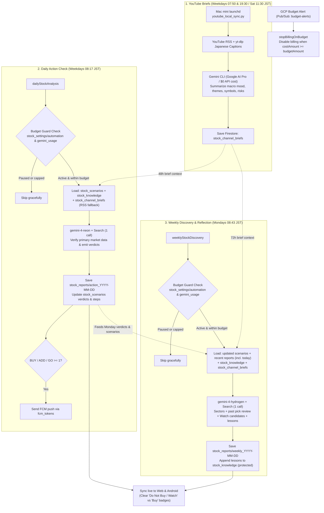

# Hibi Automated Stock Analysis Pipeline Flow

English | [日本語](stock-analysis-flow.ja.md)

Hibi's automated stock analysis runs in an ordered pipeline: **1) YouTube Summary (07:50 JST) -> 2) Weekday Daily Check (08:17 JST) -> 3) Monday Weekly Discovery & Reflection (08:43 JST)**. It runs on Firebase Cloud Functions v2 (Blaze plan + Cloud Scheduler `Asia/Tokyo`) with a Pub/Sub billing auto-stop guard, fed by a local Mac mini `launchd` summarizer (you can also invoke [stock_pipeline.py](../functions-stock/stock_pipeline.py) manually via CLI).

- **1. Local YouTube Summarizer (Mac mini `launchd`, weekdays 07:50 & 19:30, Saturdays 11:30 JST)**: Extracts captions from `@yasutakaushiroda` via `yt-dlp`, summarizes them via `gemini` CLI under a Google AI Pro account ($0 API billing), and saves briefs to Firestore `stock_channel_briefs`.
- **2. Weekday Morning Check (`dailyStockAnalysis` / 08:17 JST)**: Reads the latest YouTube briefs (or Atom RSS fallback) alongside active `HOLDING` / `WATCH` positions to emit verdicts and refresh split-buy schedules (1 API call).
- **3. Monday Weekly Discovery (`weeklyStockDiscovery` / 08:43 JST)**: Runs after YouTube and Monday's daily check, reviewing 1–4 week history (including Monday 08:17 verdicts), updating `stock_knowledge`, and proposing 2–3 new non-duplicate Watch candidates (1 API call).

---

## 1. End-to-End Flow (YouTube -> Daily -> Weekly + Dual Budget Guard)



---

## 2. Module Layout & Schedules

### Python Modules (`functions-stock/` & `scripts/stock-analysis/`)

| File | Responsibility |
| --- | --- |
| [gemini_client.py](../functions-stock/gemini_client.py) | `GeminiClient`, model token pricing, and thought-part filtering |
| [scenario_parser.py](../functions-stock/scenario_parser.py) | Ticker normalization, split-step schedule backfill, partial trailing JSON recovery |
| [firestore_store.py](../functions-stock/firestore_store.py) | Firestore read/write helpers, knowledge pruning, budget guard, and FCM push alerts |
| [youtube_channel.py](../functions-stock/youtube_channel.py) | YouTube Atom RSS parsing, `stock_channel_briefs` loader, and RSS chapter fallback |
| [stock_pipeline.py](../functions-stock/stock_pipeline.py) | `run_daily()`, `run_weekly()`, and CLI entrypoint |
| [youtube_local_sync.py](../scripts/stock-analysis/youtube_local_sync.py) | Local Mac job: VTT caption cleanup + `gemini` CLI summary + Firestore sync |

### Execution Order & Schedules (JST)

| Order | Job | Runtime | Trigger / Schedule | Purpose | Source |
| --- | --- | --- | --- | --- | --- |
| 1 | `com.hibi.youtube-sync` | Mac mini (`launchd`) | Weekdays 07:50, 19:30 / Sat 11:30 JST | Summarize `@yasutakaushiroda` locally | [install_launchd.sh](../scripts/stock-analysis/install_launchd.sh) |
| 2 | `dailyStockAnalysis` | Python 3.13 (`asia-northeast1`) | `17 8 * * 1-5` (Weekdays 08:17 JST) | Daily action verdicts & step updates | [main.py](../functions-stock/main.py) |
| 3 | `weeklyStockDiscovery` | Python 3.13 (`asia-northeast1`) | `43 8 * * 1` (Mondays 08:43 JST) | Weekly sector/Watch discovery & reflection | [main.py](../functions-stock/main.py) |
| Notify | `checkStockReminders` | Node.js 24 (`asia-northeast1`) | `30 8 * * *` (Daily 08:30 JST) | Remind via FCM when `notifyDate <= today` | [index.ts](../functions/src/index.ts) |
| Guard | `stopBillingOnBudget` | Node.js 24 (`asia-northeast1`) | Pub/Sub `budget-alerts` | Disable billing if actual cost reaches budget | [index.ts](../functions/src/index.ts) |

> **Note**: `firebase.json` `predeploy` automatically copies `.agents/skills/` into `functions-stock/skills/`. The CLI wrapper [run_pipeline.py](../scripts/stock-analysis/run_pipeline.py) imports directly from [stock_pipeline.py](../functions-stock/stock_pipeline.py).

---

## 3. Pipeline Details

### Shared Pre-flight: Budget Guard, Knowledge, YouTube Context, Scenarios
1. Fetches USD/JPY spot rate from free public endpoints (`frankfurter.dev` / `open.er-api.com`, defaulting to `159.0`).
2. `check_automation_guard()` checks `stock_settings/automation` (`enabled`) and `gemini_usage/{YYYY-MM}` against `monthlyBudgetJpy` (default `¥1,000`), aborting before calling Gemini if paused or capped.
3. `load_active_knowledge()` loads `stock_knowledge`, prioritizing pinned principles (`isPinned: true`) within a strict 12-item / 1,800-char prompt budget.
4. `load_recent_channel_briefs()` loads recent `stock_channel_briefs` summaries (48h for daily, 72h for weekly) and supplements with free Atom RSS titles/chapters if the local Mac was asleep.
5. `load_active_scenarios()` loads `HOLDING` and `WATCH` scenarios while excluding `ARCHIVED`.

### Weekday Morning: `run_daily()` (08:17 JST / 1 API call)
- **Model**: `gemini-4-neon` (temperature `0.3`, Google Search enabled, `maxOutputTokens: 16384`, 300s timeout)
- **Skill**: [stock-risk-gatekeeper](../.agents/skills/stock-risk-gatekeeper/SKILL.md)
- **Behavior**:
  1. Exits early without API calls if `active_count == 0`.
  2. Cross-checks channel hints and `stock_knowledge` against live market prices/news via Google Search, never trusting channel commentary blindly.
  3. Saves `stock_reports/action_{YYYY-MM-DD}` and updates `stock_scenarios` (`latestVerdict`, `latestVerdictReason`, `latestCheckedAt`, and pending `steps` while preserving `isDone = true`).
  4. Sends an FCM alert when one or more scenarios reach `BUY`, `ADD`, or `GO`.
  5. Android & Web render `WATCH`/`WAIT` clearly as **"✋ 様子見・まだ買わない"** (Do not buy yet) and `TRIM`/`ABORT` as **"⛔ 買いNG・警戒"**.

### Monday Weekly: `run_weekly()` (08:43 JST / 1 API call)
- **Model**: `gemini-4-hydrogen` (Thinking `HIGH`, Google Search enabled, 300s timeout)
- **Skills**: `stock-market-analyzer`, `sector-analyzer`, `stock-screener`
- **Behavior**:
  1. Reviews the last 1–4 weeks of candidates and verdicts via `load_recent_reports_summary()` (including Monday's 08:17 `daily_action` verdicts).
  2. Identifies medium/long-term sector tailwinds/headwinds and 2–3 non-duplicate Watch candidates with split `steps` and `notifyDate` reminders, saving to `stock_reports/weekly_{YYYY-MM-DD}`.
  3. Persists 0–2 newly distilled lessons (`learnedKnowledge`) into `stock_knowledge` tagged `AI自動振り返り` (`isPinned: false`).
     - **Human-on-the-loop protection**: User-created and pinned entries are never deleted. When unpinned AI notes exceed 8, only the oldest unpinned AI notes are pruned.

---

## 4. Setup Checklists

### A. Blaze Infrastructure & Automatic Billing Stop
1. Upgrade the Firebase project (`kabu-99c48`) to the **Blaze** plan.
2. Register `GEMINI_API_KEY` and deploy Cloud Functions:
   ```zsh
   firebase functions:secrets:set GEMINI_API_KEY
   firebase deploy --only functions
   ```
3. In Google Cloud Console (**Billing -> Budgets & alerts**), create a monthly budget linked to the `budget-alerts` Pub/Sub topic.
4. Grant `roles/billing.projectManager` on the Cloud Billing account to the Cloud Functions runtime service account so `stopBillingOnBudget` can unlink billing if actual cost exceeds budget.

### B. Local Mac mini YouTube Summarizer
1. Keep the Mac mini awake with display sleep only ("System Settings -> Energy -> Prevent automatic sleeping when the display is off" = ON).
2. Authenticate `gemini` CLI once interactively with your Google AI Pro account (`gemini`).
3. Place a Firebase Service Account JSON outside git and install the `launchd` schedule:
   ```zsh
   mkdir -p ~/.config/hibi
   mv ~/Downloads/kabu-99c48-*.json ~/.config/hibi/firebase-service-account.json
   chmod 600 ~/.config/hibi/firebase-service-account.json

   ./scripts/stock-analysis/run_youtube_local.sh --limit 1
   ./scripts/stock-analysis/install_launchd.sh
   ```
